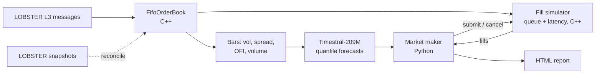

# Low Latency Order Book + lobcast

A C++ project implementing a low-latency order book, now extended into an end-to-end market analyser and backtester. Inspiration for the book from the CPPCon 2024 talk ['When Nanoseconds Matter'](https://youtu.be/sX2nF1fW7kI?si=DKKSbIE9MrRW_i24) by [David Gross](https://david-grs.github.io/about/).

The original map and vector books are still here and still benchmarked. On top of them sits **lobcast**:

- a FIFO, order-by-order book that tracks where *your* order sits in the queue,
- a replay engine for real NASDAQ L3 data ([LOBSTER](https://lobsterdata.com/)) that checks itself against LOBSTER's own snapshots after every message,
- a fill simulator with order latency, queue position, trade-throughs and hidden-order priority,
- walk-forward volatility and spread forecasts from [Timestral-209M](https://huggingface.co/mistralai/Timestral-209M), Mistral's time series foundation model,
- a market maker that uses the forecast quantiles to size its quotes and to step away before volatile bars,
- an HTML report comparing it against a naive quoter and an EWMA baseline.



The split is deliberate. The book and fill simulator run per message in C++ at roughly a microsecond each. The model runs on 10 second bars, off the hot path, and its forecasts only become usable after its measured inference latency.

## Quick start

```bash
pip install ".[timestral]"
lobcast fetch --tickers AAPL MSFT --data data
lobcast run --tickers AAPL MSFT --data data --out out/report.html
```

`lobcast run --no-model` skips Timestral and runs the baselines only. Forecasts are cached in `out/cache`, so reruns take seconds.

The C++ side builds exactly as before:

```bash
cmake -B build -DCMAKE_BUILD_TYPE=Release
cmake --build build --config Release
ctest --test-dir build --output-on-failure
./build/bench_lobster data/AAPL_2012-06-21_34200000_57600000_message_10.csv data/AAPL_2012-06-21_34200000_57600000_orderbook_10.csv
```

## How the fill simulator decides you got filled

Your order joins the back of the real queue at its price, after the order latency (1 ms by default). From then on:

| Event in the data | What happens to your order |
| :--- | :--- |
| Cancel of an order ahead of you | You move up the queue |
| Execution of an order that arrived **after** you | You would have been hit first, so you fill |
| Execution at a worse price than yours | The aggressor went through you, so you fill |
| Hidden order executes at your price | Displayed orders have priority on NASDAQ, so you fill |
| New order arrives that crosses your quote | It would have traded with you, so you fill |
| Your order would cross on arrival | Rejected (post-only) |

Because LOBSTER gives order IDs, "ahead of you" is exact, not estimated. That is the main reason this uses L3 data rather than L2 snapshots.

The main thing this does **not** model is market impact: your fills do not remove the liquidity they hit, and nobody reacts to your quotes.

## Replay fidelity

The 10-level LOBSTER files leave out messages for orders deeper than level 10, and orders resting before 9:30 have no add message. So the replay compares itself against LOBSTER's snapshot after every message and patches any difference, putting unexplained volume at the front of the queue (the conservative choice for your fills). Results on 21 June 2012:

RESULTS_FIDELITY

## Results

RESULTS_STRATEGY

## Layout

- `include/orderbook/`, `src/`: the original books plus `fifo_book`, `lobster` (fast CSV loader) and `backtest` (replay, fills, bars).
- `src/bench_lobster.cpp`: replays a real day and prints per-message latency.
- `python/bindings.cpp`: nanobind module `lobcast._core`.
- `python/lobcast/`: data fetch, bars, forecasting, strategy, metrics, report, CLI.
- `tests/`: GoogleTest suite. `python/tests/`: pytest suite, including a check that the C++ book matches an independent Python book on a random L3 stream, and lookahead tests that poison future bars and confirm past forecasts do not move.

## Original book benchmarks

> **Note on Normalization:**
> *   **x64 (Ryzen 8945HS):** Measured in CPU cycles. Converted using estimated ~5.0 GHz (Divide by 5).
> *   **ARM (Apple M2):** Measured in 24 MHz timer ticks. Converted using 41.67 ns per tick (Multiply by 41.67).

### x64 (Ryzen 8945HS)

| Metric | Map (Cycles) | Map (ns) | Vector (Cycles) | Vector (ns) |
| :--- | :--- | :--- | :--- | :--- |
| **p50** | 560 | **112** | 600 | **120** |
| **p90** | 1800 | **360** | 2000 | **400** |
| **p99** | 3440 | **688** | 3520 | **704** |
| **p99.9**| 5440 | **1088** | 5640 | **1128** |

### ARM (Apple M2)

| Metric | Map (Ticks) | Map (ns) | Vector (Ticks) | Vector (ns) |
| :--- | :--- | :--- | :--- | :--- |
| **p50** | 42 | **1,750** | 42 | **1,750** |
| **p90** | 84 | **3,500** | 125 | **5,209** |
| **p99** | 167 | **6,959** | 375 | **15,626** |
| **p99.9**| 1167 | **48,629** | 625 | **26,044** |

### Gradle

```bash
./gradlew assemble
./gradlew :lib:test
./gradlew build
```

## Data

The LOBSTER sample files are free for research and teaching. `lobcast fetch` pulls them from a public Hugging Face mirror since lobsterdata.com now gates them behind a request form. Timestral is released under Mistral's modified MIT license.
